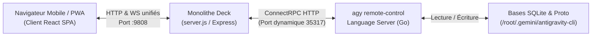

# Architecture & Guide Technique : Antigravity Deck (`agy-deck`)

> Ce document synthétise l'architecture, les flux de données et les règles internes du projet afin de permettre aux agents et développeurs de travailler immédiatement sans avoir à relire l'intégralité du code source.

---

## 1. Vue d'Ensemble & Modèle Hub

Antigravity Deck est une interface web & PWA unifiée (Architecture Monolithe Node.js Express servant à la fois l'API ConnectRPC, les WebSockets et le bundle statique Next.js 16) permettant de piloter à distance le démon local d'Antigravity (`agy`).



### Concepts Clés
- **Monolithe Unifié** : Un seul processus Node.js (`server.js`) écoute sur le port `:9808`. Il sert les routes d'API `/api/*`, gère les WebSockets sur le même port via HTTP Upgrade, et distribue l'interface statique compilée (`frontend/out`).
- **Multi-chat nominal & Cache Client** : Le frontend conserve en mémoire vive un cache des 10 dernières conversations actives (`convCacheRef`). Le changement de conversation est instantané (zéro écran blanc) et les flux en arrière-plan continuent d'enrichir le cache.
- **Icônes d'activité en temps réel** : La sidebar affiche distinctement l'état de chaque conversation (Thinking/Generating avec `Brain`, Waiting user input avec `AlertCircle`, Done avec `CheckCircle2`, Error avec `AlertTriangle`).
- **Hub Model** : Un seul Language Server central tourne sur la machine sous `agy remote-control serve`. Ses ports HTTP et gRPC sont attribués aléatoirement à chaque démarrage.
- **Optimisation RPC & Polling** : Les appels vers le Language Server sont dédupliqués par socket socket (`port:csrfToken`). Le polling actif s'exécute à 2s avec un re-scan restreint aux étapes de queue (taille 3 au lieu de 20), et les blocages manuels (`WAITING_FOR_USER`) bénéficient d'un cooldown de 10s pour supprimer le pilonnage CPU inutile.
- **Authentification & CSRF** : Chaque appel au Language Server nécessite l'en-tête `x-codeium-csrf-token` et `Connect-Protocol-Version: 1`. Le token CSRF est stocké en mémoire dans le processus Go et dans le fichier `hub.json`.
- **Jetbox & Trajectoires** : Les conversations, steps et diffs ne sont pas générés par Deck mais streamés depuis les structures de données d'`agy`.

---

## 2. Cartographie du Code Source

### Backend (`src/`, `scripts/`)

| Fichier / Dossier | Rôle & Responsabilité | Points d'Attention |
| :--- | :--- | :--- |
| `server.js` | Point d'entrée serveur Express unifié (monolithe), configuration des middlewares, API ConnectRPC, WebSockets et distribution du bundle statique `frontend/out`. | Port d'écoute : `9808` (configurable via `PORT`). |
| `src/detector.js` | Détecteur automatique du Language Server. Boucle adaptative (10s si connecté, 2s si déconnecté). | Invoque `scripts/discover-hub.py` si `hub.json` est invalide ou absent. |
| `scripts/discover-hub.py` | Découverte ultra-rapide (< 0.4s) du PID `agy`, de son port HTTP via `ss -tlpn` et extraction directe du token CSRF depuis la mémoire Go (`ANTIGRAVITY_CSRF_TOKEN=`). | Ne pas utiliser de regex exhaustives sur le heap Go (360 Mo+) ; toujours privilégier la recherche de sous-chaîne directe. |
| `src/proxy.js` | Proxy HTTP inverse vers le Language Server. Injecte le token CSRF et gère les timeouts. | Valide strictement les méthodes autorisées contre la whitelist. |
| `src/ls-method-whitelist.js` | Liste blanche des méthodes RPC autorisées via le proxy. | Contient `RetrieveUserQuotaSummary`, `GetCascadeModelConfigData`, etc. Toute nouvelle méthode LS doit y être déclarée. |
| `src/ws.js` | Serveur WebSocket diffusant l'état du serveur (`status`, `conversations_updated`, etc.). | Maintient la connexion temps réel avec le frontend. |
| `src/auto-accept.js` | Automatisation des autorisations d'outils et de modifications de code lorsqu'activée. | Intercepte les étapes en attente (`WAITING_FOR_USER`). |
| `src/routes/conversations.js` | Routes `/api/conversations`, `/api/models`, `/api/user/quota-summary`. | **Critique pour les quotas** : regroupe les modèles par famille (`Gemini Models`, `Claude and GPT models`, `Gemini 4 Argon`) et calcule les quotas effectifs (5h et hebdomadaire). |
| `src/routes/cascade.js` | Envoi de prompts (`/api/cascade/send`), interactions (`/api/cascade/:id/accept`), annulations et rollbacks. | Point central des interactions avec le flux de travail actif. |
| `src/routes/workspaces.js` | Gestion des dossiers de projets et synchronisation des instances virtuelles. | Filtre les conversations par projet. |
| `src/routes/settings.js` | Paramètres utilisateur (thème, auto-accept, notifications, modèle par défaut). | Persistance locale dans `settings.json`. |

### Frontend (`frontend/`)

| Fichier / Dossier | Rôle & Responsabilité | Points d'Attention |
| :--- | :--- | :--- |
| `frontend/app/page.tsx` | Composant racine. Gère la conversation active, le routage interne des panneaux (Timeline, Logs, Settings, Usage, Analytics). | Utilise `key={currentConvId}` pour forcer le remontage propre des vues sans fuite d'état. |
| `frontend/components/app-sidebar.tsx` | Barre latérale PWA. Gestion des conversations, épinglage (`pinned`), archivage, statuts animés (run/waiting/done) et filtres multi-critères. | Boutons typés `<button type="button">` pour éviter les soumissions accidentelles. |
| `frontend/components/chat-view.tsx` | Vue principale du chat. Input textarea, upload d'images, sélecteur de modèle avec badges 5h/hebdo, déclencheur de la modale Usage. | Affiche les jauges et badges (`5h: XX% · H: XX%`, ou `0% épuisé`). |
| `frontend/components/usage-view.tsx` | Composant Usage répliquant fidèlement l'interface mobile officielle Antigravity. | Affiche les anneaux de progression circulaires SVG (`CircularQuotaRing`), le calcul précis des temps de reset (`formatResetCountdown`) et l'explication officielle. |
| `frontend/components/user-profile.tsx` | Vue Compte & Plan. Intègre les infos d'abonnement Google, le sélecteur de profil (`ProfileSwitcher`) et la vue d'usage. | Utilisé lors du clic sur le profil utilisateur. |
| `frontend/lib/cascade-api.ts` | Couche d'abstraction API client. Types TypeScript complets, méthodes `getModels()`, `getQuotaSummary()`, calculs de quotas dans `getModelQuotaDetails()`. | Contient les formules de conversion de temps et pourcentages. |
| `frontend/public/sw.js` | Service Worker PWA. | Stratégie **network-first** pour les navigations HTML pour garantir la mise à jour immédiate lors d'un nouveau déploiement. |

---

## 3. Logique Spécifique des Quotas & Modèles

### Architecture des Quotas Antigravity
Les quotas dans Antigravity ne sont **pas** alloués par modèle individuel, mais mutualisés par **groupes de modèles** via `RetrieveUserQuotaSummary` :
1. **Gemini Models** (Flash, Pro) : Fenêtre glissante de **5 heures** (`gemini-5h`) + Fenêtre **hebdomadaire** (`gemini-weekly`).
2. **Claude and GPT models** (Sonnet, Opus, GPT-OSS) : Fenêtre **hebdomadaire** (`3p-weekly`) + Fenêtre 5h (`3p-5h`).
3. **Gemini 4 Argon** : Fenêtre **hebdomadaire** dédiée (`gemini-argon-wtu-weekly`).

### Règle d'Épuisement (0% Left)
- Si le quota hebdomadaire d'un groupe tombe à **0%**, **tous les modèles de ce groupe sont épuisés** et inutilisables, même si la fenêtre glissante de 5h indique 100% (le bucket 5h est alors marqué `disabled: true`).
- **Piège Protobuf** : Lors de la sérialisation JSON par ConnectRPC/Protobuf, un flottant égal à `0.0` pour `remainingFraction` est **omis** du payload JSON. Un fallback naïf `remainingFraction ?? 1` afficherait 100% au lieu de 0% ! La règle appliquée dans `conversations.js` et `cascade-api.ts` détecte explicitement l'omission ou la présence d'un `resetTime` sans fraction pour fixer le quota à `0%`.

---

## 4. Cycle de Vie du Service & Déploiement

- **Dépôt de développement** : `/root/repos/agy-deck` (branche active : `patched-agy-detect-ui`).
- **Instance de production live** : `/opt/antigravity-deck` (gérée par `systemd: antigravity-deck.service`).
- **Reverse Proxy** : Caddy sur LXC 104 (`192.168.1.55`) pointant vers `192.168.1.7:9808`.

### Procédure de Déploiement des Modifications
1. Travailler et tester dans `/root/repos/agy-deck`.
2. Valider le build frontend :
   ```bash
   cd /root/repos/agy-deck/frontend && npm run build
   ```
3. Committer et pusher sur le fork (`origin`) et Forgejo (`forgejo`).
4. Synchroniser vers `/opt/antigravity-deck` :
   ```bash
   cd /opt/antigravity-deck && git pull origin patched-agy-detect-ui
   cd /opt/antigravity-deck/frontend && npm run build
   ```
5. Redémarrer le service (**après confirmation humaine**) :
   ```bash
   systemctl restart antigravity-deck.service
   ```
